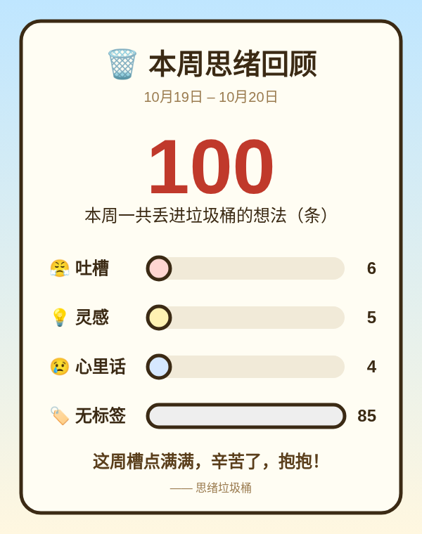
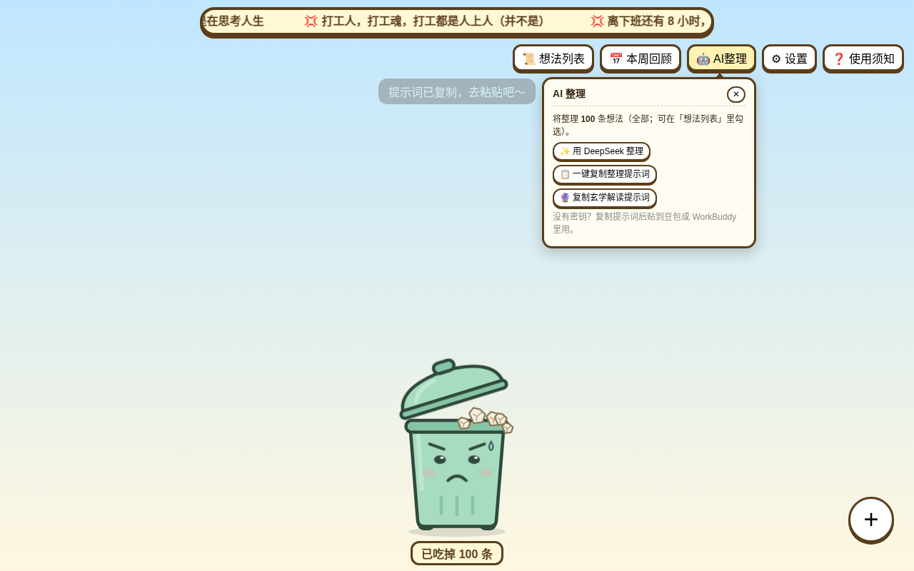

# 🗑️ 思绪垃圾桶 · Thought Trash Bin — 离线、免注册的想法垃圾桶 / Offline, no-account brain dump

把烦心事、灵感、心里话写下来，拖进垃圾桶就保存；数据只存在你的浏览器里，可以用 AI 整理成待办。
Write rants, ideas and 3am thoughts, drag them into the bin to save. Notes stay in your browser; let AI sort them into tasks when you want.

## 👉 [直接打开 / Open it: https://thought-trash-bin.pages.dev](https://thought-trash-bin.pages.dev)

免费 · 开源（MIT）· 不用注册 · 离线可用 · 中英双语
Free · Open source (MIT) · No sign-up · Works offline · Chinese / English

| 中文 | English |
|---|---|
|  |  |
|  |  |
|  |  |

## 常见问题 · FAQ

**需要注册或联网吗？ / Do I need an account or internet?**
不用注册。除了 AI 整理，其他功能都能离线使用。
No account. Everything except AI sort-out works offline.

**我的想法存在哪里？ / Where are my notes stored?**
存在你自己浏览器的 IndexedDB 里；在 Edge / Chrome 里还可以选一个文件夹，每条存成一个 `.md` 文件。没有服务器、没有数据库。
In your own browser (IndexedDB). In Edge / Chrome you can also pick a folder and each note is saved as a `.md` file. No server, no database.

**AI 整理怎么用？密钥安全吗？ / How does AI sort-out work? Is my key safe?**
填入你自己的 DeepSeek 密钥，它只存在你的浏览器里，只在你点「AI 整理」时随请求发给 DeepSeek。没有密钥也能一键复制提示词，贴到任何 AI 里用。
Add your own DeepSeek key; it stays in your browser and is sent to DeepSeek only when you click AI sort-out. No key? Copy the ready-made prompt into any AI.

**换电脑或清缓存会丢吗？ / Will I lose notes if I clear my browser?**
清除浏览器数据会删掉浏览器里的想法。请用「💾 导出备份」导出 `.md`，或使用文件夹保存。
Clearing browser data removes them. Use "💾 Export backup" or folder saving.

**能给想法分类吗？ / Can I categorize notes?**
可以，有心情标签：😤 吐槽 / 💡 灵感 / 😢 心里话，列表可筛选和搜索。
Yes: mood tags 😤 Rant / 💡 Idea / 😢 Deep thoughts, with filter and search.

**有回顾功能吗？ / Is there a review?**
有「本周回顾」统计卡片，可下载 PNG 或分享。
Yes, a weekly recap card you can download as PNG or share.

**支持英文吗？ / English?**
按浏览器语言自动切换，右上角「中 / EN」随时切换。
Follows your browser language; switch anytime with "中 / EN".

**可以自己部署吗？ / Can I self-host?**
可以，纯静态网页，见下方「自己部署」。
Yes, it's a plain static site — see "Self-host" below.

## 功能 · Features

- **写下来，丢进去**：点空白处或「+」新建一个漂浮的对话框，写完拖进垃圾桶，桶会“嚼嚼嚼”。
  **Write it, toss it**: click anywhere or "+" to make a floating card, then drag it into the bin and watch it chew.
- **不会真的消失**：想法存成 Markdown，可以搜索、删除、导出全部 `.md`；Edge / Chrome 还能直接存到你选的文件夹。
  **Nothing is really lost**: notes are saved as Markdown; search, delete or export them all. In Edge / Chrome you can save straight to a folder you pick.
- **心情标签**：😤 吐槽 / 💡 灵感 / 😢 心里话，列表可按标签筛选。
  **Mood tags**: 😤 Rant / 💡 Idea / 😢 Deep thoughts, with filtering in the list.
- **会变表情的桶**：没整理的想法多了会不开心，满 20 条盖子合不上还会打嗝。
  **A bin with feelings**: it frowns when notes pile up unsorted and burps when it's over 20.
- **本周回顾**：一张统计卡片，可下载 PNG 或分享。
  **Weekly recap**: a summary card you can download as PNG or share.
- **AI 整理**：填入自己的 DeepSeek 密钥，把想法整理成项目和步骤；没有密钥也能一键复制提示词，贴到别的 AI 里用。另有一个仅供娱乐的「玄学解读」提示词。
  **AI sort-out**: add your own DeepSeek key to turn notes into projects and steps, or copy a ready-made prompt to use in any AI. There's also a just-for-fun "fortune" prompt.
- **彩蛋、快捷键、自定义横幅、新手引导**。
  **Easter eggs, shortcuts, custom banner lines, and a guided tour.**
- **中英双语**：按浏览器语言自动选择，右上角「中 / EN」随时切换并记住。
  **Bilingual**: follows your browser language; switch anytime with "中 / EN" (remembered).
- **离线可用**：除了 AI 整理，其他功能都不需要联网。
  **Works offline**: everything except AI sort-out works without a connection.

## 隐私 · Privacy

- 所有想法只保存在你自己的浏览器（或你选的文件夹）里，没有服务器、没有数据库、没有账号。
  All notes stay in your own browser (or the folder you pick). No server, no database, no account.
- DeepSeek 密钥只存在你的浏览器里，只有你点「AI 整理」时才会随请求发给 DeepSeek。
  Your DeepSeek key is stored only in your browser and is sent to DeepSeek only when you click AI sort-out.
- 语言切换只看浏览器设置，不查 IP。
  Language detection uses only your browser setting — no IP lookup.
- 网站使用 Cloudflare Web Analytics 做匿名访问统计，不包含任何想法内容。
  The site uses Cloudflare Web Analytics for anonymous visit counts; it never includes your notes.

## 作者 · Author

- X: [@PinkY63990316](https://x.com/PinkY63990316)
- GitHub: [IvanYang297](https://github.com/IvanYang297)

有想法或发现 bug，欢迎来 X 找我，或在 GitHub 提 Issue。
Ideas? Bugs? Find me on X or open a GitHub issue.

## 许可证 · License

MIT，见 [LICENSE](LICENSE)。 / MIT — see [LICENSE](LICENSE).

<details>
<summary>自己部署 / 本地运行 · Self-host / run locally</summary>

纯静态网页，用任意静态服务器打开即可（因为用了 ES 模块，不能直接双击 `index.html`）：
A plain static site; serve it with any static server (ES modules mean double-clicking `index.html` won't work):

```bash
python3 -m http.server 8000
# 打开 / open http://localhost:8000
```

也可以部署到 GitHub Pages 或 Cloudflare Pages。文案在 `js/i18n.js`。测试 / Tests: `python3 tests/smoke_test.py`（需要 / requires Playwright）。

Can also be deployed to GitHub Pages or Cloudflare Pages. UI text lives in `js/i18n.js`.

</details>
