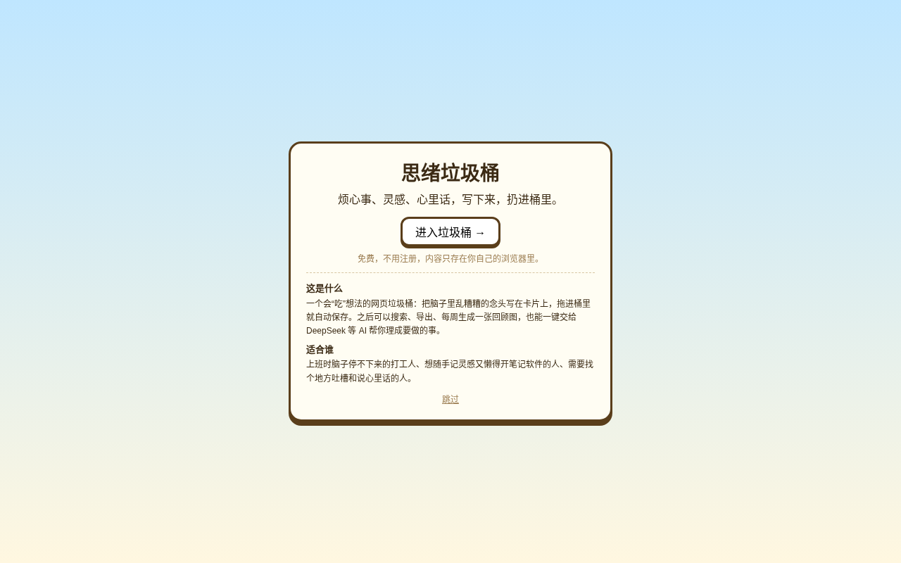
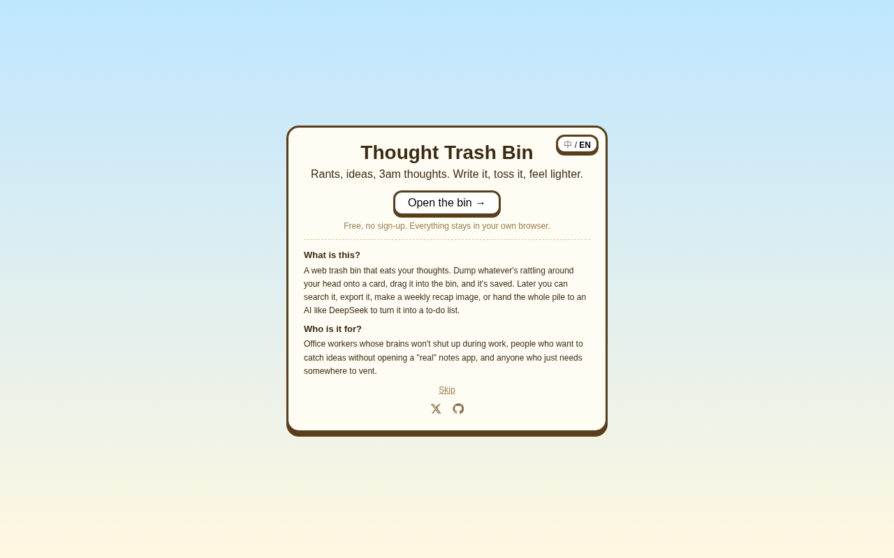
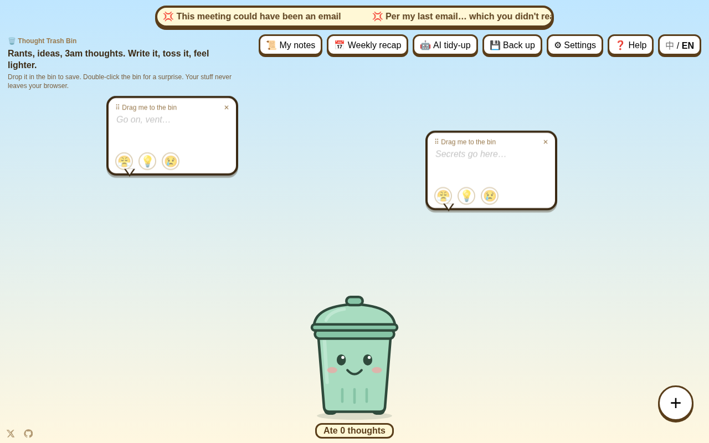

# 🗑️ 思绪垃圾桶 · Thought Trash Bin

把乱糟糟的想法、上班吐槽、心里话随手丢进垃圾桶，写完就轻松一点。
Rants, ideas, 3am thoughts — write it, toss it, feel lighter.

## 👉 [直接打开 / Open it: https://thought-trash-bin.pages.dev](https://thought-trash-bin.pages.dev)

免费、不用注册，打开网页就能用。
Free, no sign-up — just open the page.

| 中文 | English |
|---|---|
|  |  |
|  |  |

当前版本 **v1.2.1**，更新记录见 [CHANGELOG.md](CHANGELOG.md)。
Current version **v1.2.1**. See [CHANGELOG.md](CHANGELOG.md) for release notes.

## 功能 · Features

- **写下来，丢进去**：点空白处或「+」新建一个漂浮的对话框，写完拖进垃圾桶，桶会“嚼嚼嚼”。
  **Write it, toss it**: click anywhere or "+" to make a floating card, then drag it into the bin and watch it chew.
- **不会真的消失**：想法存成 Markdown，可以搜索、删除、导出全部 `.md`；Edge / Chrome 还能直接存到你选的文件夹。
  **Nothing is really lost**: notes are saved as Markdown; search, delete or export them all. In Edge / Chrome you can save straight to a folder you pick.
- **心情标签**：😤 吐槽 / 💡 灵感 / 😢 心里话，列表可按标签筛选。
  **Mood tags**: 😤 Rant / 💡 Idea / 😢 Deep thoughts, with filtering in the list.
- **会变表情的桶**：没整理的想法多了会不开心，满 20 条盖子合不上还会打嗝。
  **A bin with feelings**: it frowns when notes pile up unsorted and burps when it's over 20.
- **本周回顾**：一张统计卡片，可下载 PNG 或分享。
  **Weekly recap**: a summary card you can download as PNG or share.
- **AI 整理**：填入自己的 DeepSeek 密钥，把想法整理成项目和步骤；没有密钥也能一键复制提示词，贴到别的 AI 里用。另有一个仅供娱乐的「玄学解读」提示词。
  **AI sort-out**: add your own DeepSeek key to turn notes into projects and steps, or copy a ready-made prompt to use in any AI. There's also a just-for-fun "fortune" prompt.
- **彩蛋、快捷键、自定义横幅、新手引导**。
  **Easter eggs, shortcuts, custom banner lines, and a guided tour.**
- **中英双语**：按浏览器语言自动选择，右上角「中 / EN」随时切换并记住。
  **Bilingual**: follows your browser language; switch anytime with "中 / EN" (remembered).
- **离线可用**：除了 AI 整理，其他功能都不需要联网。
  **Works offline**: everything except AI sort-out works without a connection.

## 隐私 · Privacy

- 所有想法只保存在你自己的浏览器（或你选的文件夹）里，没有服务器、没有数据库、没有账号。
  All notes stay in your own browser (or the folder you pick). No server, no database, no account.
- DeepSeek 密钥只存在你的浏览器里，只有你点「AI 整理」时才会随请求发给 DeepSeek。
  Your DeepSeek key is stored only in your browser and is sent to DeepSeek only when you click AI sort-out.
- 语言切换只看浏览器设置，不查 IP。
  Language detection uses only your browser setting — no IP lookup.
- 网站使用 Cloudflare Web Analytics 做匿名访问统计，不包含任何想法内容。
  The site uses Cloudflare Web Analytics for anonymous visit counts; it never includes your notes.

## 作者 · Author

- X: [@PinkY63990316](https://x.com/PinkY63990316)
- GitHub: [IvanYang297](https://github.com/IvanYang297)

有想法或发现 bug，欢迎来 X 找我，或在 GitHub 提 Issue。
Ideas? Bugs? Find me on X or open a GitHub issue.

## 许可证 · License

MIT，见 [LICENSE](LICENSE)。 / MIT — see [LICENSE](LICENSE).

<details>
<summary>自己部署 / 本地运行 · Self-host / run locally</summary>

纯静态网页，用任意静态服务器打开即可（因为用了 ES 模块，不能直接双击 `index.html`）：
A plain static site; serve it with any static server (ES modules mean double-clicking `index.html` won't work):

```bash
python3 -m http.server 8000
# 打开 / open http://localhost:8000
```

也可以部署到 GitHub Pages 或 Cloudflare Pages。文案在 `js/i18n.js`。测试 / Tests: `python3 tests/smoke_test.py`（需要 / requires Playwright）。

Can also be deployed to GitHub Pages or Cloudflare Pages. UI text lives in `js/i18n.js`.

</details>
