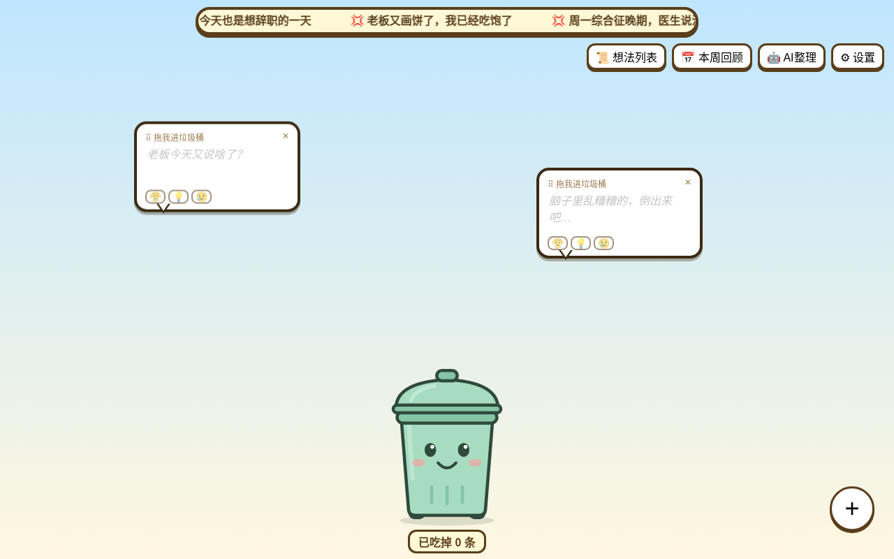

# 🗑️ 思绪垃圾桶

一个把乱糟糟的想法、上班吐槽、心里话随手“丢掉”的小网页。丢进去的东西不会消失，而是存成 Markdown 文件，需要时还能让 AI 帮你整理成计划。



## 功能（第一版）
- **滚动吐槽横幅**：顶部循环播放吐槽上班的句子（在 `js/banner.js` 里改）。
- **冒险岛风格对话框**：圆角粗描边、带小尖角、轻轻漂浮；点空白处或右下角「+」新建，直接打字，可拖动。
- **丢进垃圾桶**：把对话框拖进底部的大垃圾桶就保存，桶会“嚼嚼嚼”，显示「已吃掉 N 条」。
- **彩蛋**：双击垃圾桶，或 2 秒内连点 5 下，纸片爆出来，上面写着日期时间和当时的想法。
- **本地保存**：Edge / Chrome 可在「设置」里选一个文件夹，每条想法存成一个 `.md`；其他浏览器存在浏览器里（IndexedDB），可在列表里「导出全部 .md」。
- **想法列表**：按时间倒序查看，可搜索、删除、勾选。
- **AI 整理**：在「设置」里填 DeepSeek 密钥（只存在本浏览器），一键把想法整理成项目 / 步骤 / 优先级，结果存成 `.md`。没有密钥时可「一键复制整理提示词」，贴到豆包或 WorkBuddy。
- **离线可用**：除了 AI 整理，全部功能不需要联网。

## 怎么运行
因为用了 ES 模块，需要通过本地服务器打开（直接双击 `index.html` 不行）：

```bash
cd thought-trash-bin
python3 -m http.server 8000
```
然后用 Edge 或 Chrome 打开 <http://localhost:8000>。

也可以直接部署到 GitHub Pages：仓库设置 → Pages → 选择分支根目录即可。

## 目录结构
```
index.html          页面
css/style.css       样式
js/main.js          入口，把各模块串起来
js/banner.js        滚动横幅（文案数组）
js/bubbles.js       漂浮对话框
js/trashbin.js      垃圾桶、计数、咀嚼动画
js/storage.js       IndexedDB / 文件夹 .md 保存与导出
js/list.js          想法列表
js/ai.js            DeepSeek 整理与提示词
js/easter-eggs.js   纸片爆炸彩蛋
tests/smoke_test.py 自动化冒烟测试（Playwright）
```
每个功能一个文件，以后加新想法时通常只需新增一个模块，再在 `main.js` 里接上，不容易牵一发动全身。

## 测试
```bash
pip install playwright && python3 -m playwright install chromium
python3 tests/smoke_test.py
```

## 隐私
想法只保存在你的电脑 / 浏览器里。DeepSeek 密钥只存在浏览器 localStorage，仅在你点击「AI 整理」时随请求发送给 DeepSeek。

## 许可证
MIT
